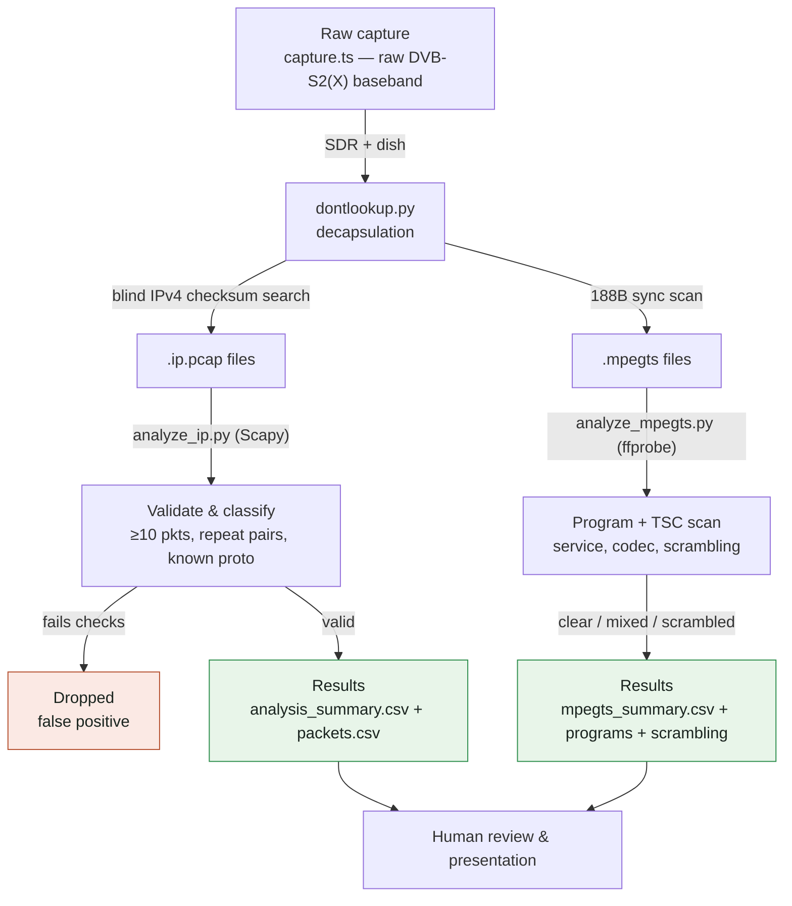

# DVB-S2 Traffic Analysis Scripts

Analysis scripts for processing the outputs of [dontlookup.py](https://github.com/ucsdsysnet/dontlookup), the open-source DVB-S2(X) parser released with the *Don't Look Up* satellite security study by researchers at UC San Diego.

These scripts form the second stage of the pipeline: dontlookup.py decapsulates raw transponder captures; these scripts analyze what it found.

---

## Pipeline overview



---

## Scripts

### `analyze_ip.py` — Scapy-based IP traffic analysis

Reads `.ip.pcap` files produced by dontlookup's IP, GSE, and reverse-encoded parser paths. For each file it:

- Validates whether the output looks like real IP traffic or a false positive from the blind header search
- Tags each packet by source address type: `link-local`, `private`, or `public`
- Estimates what fraction of each packet's payload is plaintext
- Writes a per-packet CSV and an overall summary CSV

**Requirements**

```
pip install scapy
```

**Usage**

```bash
python3 analyze_ip.py capture.ts.dvbs2.ip.pcap
python3 analyze_ip.py *.ip.pcap
```

**Outputs**

| File | Contents |
|------|----------|
| `<input>_packets.csv` | One row per IP packet with src/dst, address type, protocol, ports, payload size, plaintext fraction |
| `analysis_summary.csv` | One row per input file — validation result, unique IPs, address type breakdown, mean plaintext fraction |

---

### `analyze_mpegts.py` — ffprobe + scrambling analysis

Reads `.mpegts` files produced by dontlookup's transport-stream parser path. For each file it:

- Runs ffprobe to extract program and stream metadata (service names, codecs, languages)
- Scans every 188-byte TS packet and reads the `transport_scrambling_control` field
- Classifies each file as `clear`, `mostly clear`, `mixed`, `mostly scrambled`, or `fully scrambled`
- Writes program metadata and scrambling CSVs

**Requirements**

- [ffmpeg](https://ffmpeg.org/download.html) (provides `ffprobe`) — must be on PATH
- Python 3.8+ stdlib only (no pip installs)

**Usage**

```bash
python3 analyze_mpegts.py capture.ts.dvbs2.mpegts
python3 analyze_mpegts.py *.mpegts
```

**Outputs**

| File | Contents |
|------|----------|
| `mpegts_programs.csv` | One row per stream — program ID, service name, provider, codec, resolution, language |
| `mpegts_scrambling.csv` | Per-file TSC field counts broken down by value (00/01/10/11) |
| `mpegts_summary.csv` | One row per file — program count, scrambling percentage, encryption status |

---

## Understanding the outputs

### False-positive IP detection

dontlookup's IP parser finds packets by testing the IPv4 checksum at every byte offset in the baseband stream. Encoded video can coincidentally pass this check. `analyze_ip.py` flags likely false positives based on:

- Fewer than 10 IP packets total
- No repeating source/destination address pairs
- No recognisable IP protocol values (TCP, UDP, ICMP, etc.)

Files that fail this check are still written to the summary CSV with `valid = False` so you have a record of what was dropped and why.

### transport_scrambling_control values

The 2-bit TSC field in every MPEG-TS packet header indicates encryption status:

| Value | Meaning |
|-------|---------|
| `00` | Not scrambled |
| `01` | Reserved (treated as clear) |
| `10` | Scrambled, even key |
| `11` | Scrambled, odd key |

A service that is fully in the clear will have 100% `00` packets. A legitimately scrambled broadcast service will be 100% `10`/`11`. A `mixed` result (significant counts of both) may indicate a multi-service transponder where some programs are encrypted and others are not, or a parser path that partially misaligned.

---

## Citation

If you use these scripts in your research, please also cite the original dontlookup study:

> Bisping et al., *Don't Look Up: Examining the Cybersecurity of Consumer Satellite Terminals*, USENIX Security 2024.
